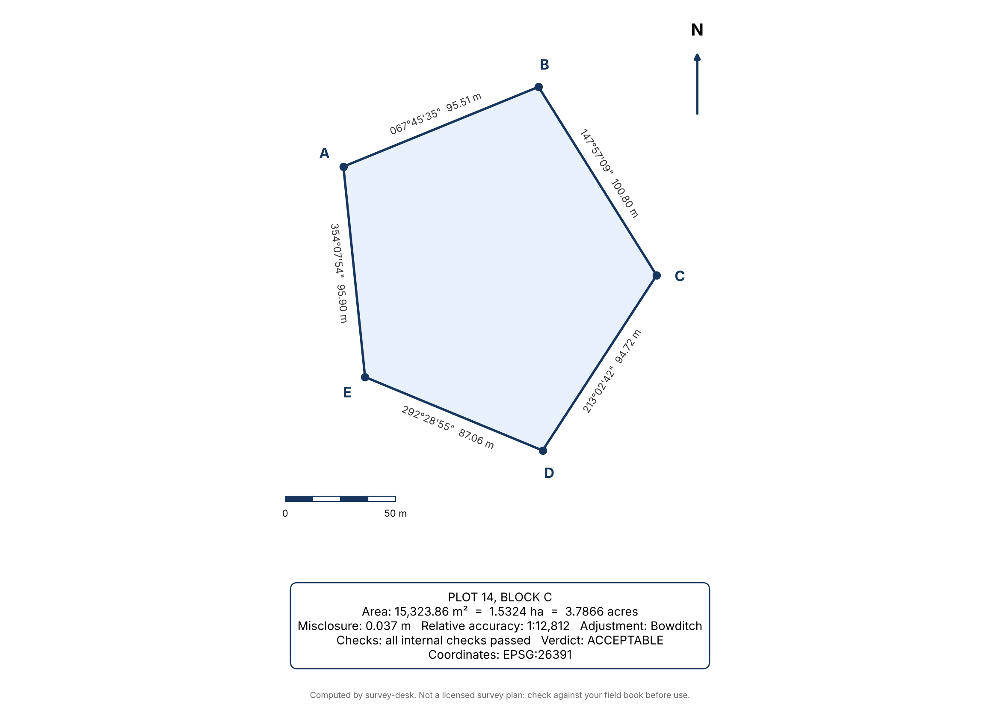

# survey-desk

Exact land-survey computation for [Hermes Agent](https://hermes-agent.nousresearch.com). LLMs are unreliable at bearings, closure error and datum shifts. This plugin gives Hermes a survey desk that computes them exactly, checks its own work, and sends the plan back in chat.

Send a field book from Telegram, get back a drawn plan, a DXF for CAD, and a KML you can open in Google Earth.



## What it does

| Tool | Job |
|---|---|
| `survey_traverse` | Closed-traverse computation: misclosure, relative accuracy (1:N), Bowditch or transit adjustment, adjusted coordinates and bearings, area (m², ha, acres). |
| `survey_plan` | Same computation plus a drawn plan (bearings and distances on every line, beacons, north arrow, scale bar, area box) exported as PNG, PDF, DXF, and, when a CRS is given, georeferenced KML and GeoJSON. |
| `survey_convert` | PROJ coordinate conversion between WGS84, Minna datum, Nigeria West/Mid/East belts, UTM zones, or any EPSG code. |
| `survey_inverse` | Bearing and distance between two coordinate pairs. |

Also a `/survey` slash command (paste a field book, get the summary and files) and a bundled `field-book` skill that tells the agent to use the tools instead of doing survey arithmetic itself.

## It checks its own work

Every traverse runs these checks and reports them:

- **Closes after adjustment**: the adjusted traverse returns to the start station.
- **Two independent area methods agree**: coordinate (shoelace) method vs double-meridian-distance method.
- **Simple polygon**: the boundary does not cross itself (a mis-ordered station list gives a plausible but wrong area; this catches it).
- **Meets tolerance**: relative accuracy against the limit you set (default 1:5000).

When a traverse fails tolerance, the plugin names the leg most likely to hold the blunder and the value it probably should have been. Each leg is tested two ways: a wrong distance leaves a misclosure parallel to the leg; a wrong bearing rotates the leg and leaves a chord-shaped misclosure. Example on the bundled demo field book, after a digit transposition in a distance:

```
Misclosure 9.037 m, relative accuracy 1:51
Suspect leg D-E (distance): 78.05 -> 87.087 (distance looks 9.037 m short, fit 100.0%)
```

The true value was 87.05. These are ranked candidates, not proof: symmetric or parallel legs can explain a misclosure equally well, and the plugin says so when that happens. Re-measure the top leg before changing the record.

## Field-book format

```
title: Plot 14, Block C
crs: minna_west
start: A 164500.00 380200.00
A-B 067-45-46 95.52
B-C 147-56-59 100.81
C-D 213-02-26 94.72
D-E 292-28-56 87.05
E-A 354-08-08 95.90
```

Bearings are whole-circle (`067-45-46`, `067°45'46"`, `67.7628`) or quadrant (`N67-45-46E`). Distances are metres. The last leg returns to the start station. Optional lines: `method: transit`, `tolerance: 10000`. See `examples/demo-fieldbook.txt`.

## Coordinate systems

Aliases: `wgs84`, `minna`, `minna_west`, `minna_mid`, `minna_east`, `minna_utm31`, `minna_utm32`, `utm31n`, `utm32n`, or any EPSG code (`EPSG:26391`). Geographic points are longitude (x), latitude (y).

`survey_convert` and the KML/GeoJSON export are honest about limits:

- They report the exact PROJ operation used and its published datum-shift accuracy (for example Minna to WGS 84 is about ±15 m in the west). A parcel placed on Google Earth is only as accurate as that shift.
- They warn when points fall outside a CRS's area of use (Minna UTM 31N, for instance, only covers the far south).
- They do a round-trip check on every conversion.

## Limits

- v1 handles **closed-loop traverses** in **metres**. Link traverses between known points, angle-based input, and levelling are not included.
- The default tolerance of 1:5000 is a placeholder. Set the limit your surveying authority requires.
- Output is a computation aid. It is not a licensed survey plan, and the drawing says so.

## Disclosure (catalog rule 13)

- **Network calls:** none. PROJ network access is off by default and is not enabled.
- **Reads outside the plugin's data:** none. Plans are written to `<hermes home>/plugin-data/survey-desk/plans/`.
- **Shell commands, background processes, stored credentials, telemetry:** none.
- **Dependencies** (declared in `pyproject.toml`, with upper bounds): pyproj, matplotlib, ezdxf.

## Install and test

```
hermes plugins install survey-desk
```

From a checkout:

```
pip install -e . pytest
python -m pytest tests
hermes plugins validate . --install-deps
hermes plugins doctor . --ci
```

## License

MIT
